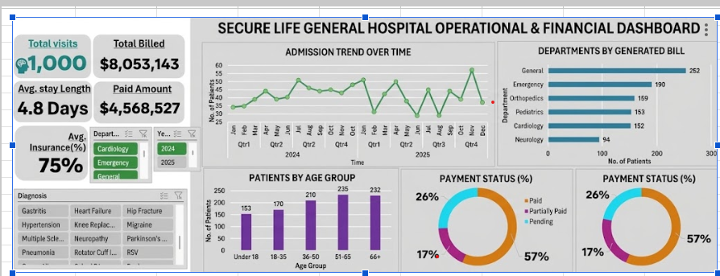

# SECURE LIFE GENEREAL HOSPITAL OPERATIONAL AND FINANCIAL PERFORMANCE REPORT

## INTRODUCTION
This report represents the operational and financial performance of Secure Life General Hospital, apparently on the leverage of the hospital’s patient admission, billing and insurance dataset.

## Dataset
Every individual hospital visit is assigned a distinct reference code known as the Patient ID, which corresponds to the Patient Name of the individual receiving medical care. Each entry records the patient's Age in years at the exact time of the visit alongside their documented Gender. The timeline of care is tracked via the Admission Date and Discharge Date, marking when the patient was formally admitted to and subsequently left the facility. Medical care is categorized by the specific Department providing treatment—such as Cardiology, Emergency, or Orthopedics—and detailed by the primary Diagnosis identified for the patient. Financially, records capture the Total Bill Amount charged for all provided services, the exact Insurance Coverage (%) proportion financed through health insurance, and the current Payment Status, which indicates whether the bill is Paid, Pending, or Partially Paid. To view the dataset ,please [click here](https://docs.google.com/spreadsheets/d/1ducUbh6rfn2v_2ji4QEiCx1hENcvJHYS/edit?usp=sharing&ouid=100099860447297143774&rtpof=true&sd=true)

## PROBLEM STATEMENT
Secure Life General Hospital is experiencing notable shifts in-patient admissions, rising unpaid medical bills, and varying levels of insurance coverage across its departments. To evaluate operational performance, track payment status, and improve executive decision-making, the hospital seeks to leverage its patient admission, billing, and insurance dataset. However, the organization currently lacks a unified, consolidated report that provides a comprehensive overview of its operational and financial performance.

## VISUALIZATION
Excel was used to generative an interactive and insightful dashboard which reveals about the hospital fiancial and operational performance.

## INSIGHTS
This operational and financial analysis of Secure Life General Hospital reveals that while high patient volumes and seasonal late Q4,quarter surges are driven by General Medicine and Emergency care, overall financial performance is primarily anchored by high-acuity departments like Orthopedics and Cardiology—though hospital cash flow remains constrained by a high 43% rate of unpaid or pending bills.

## RECOMMENDATION
1.***Financial Optimization***: Implement automated insurance pre-authorizations, structured payment plans, and improved payer negotiations to reduce pending and partially paid patient bills from 43% to under 20% while minimizing out-of-pocket patient debt shifts.

2.***Bed & Discharge Efficiency***: Optimize clinical discharge protocols in high-stay departments like Orthopedics (7.6 days average) and Cardiology (6.8 days average) to safely increase bed turnover rates without compromising care quality.

3.***Surge & Capacity Readiness***: Proactively scale nurse-to-patient staffing ratios and bed availability during peak Q4 seasonal surges (especially November) to prevent bottlenecks in the Emergency department.

## CONCLUSION
Secure Life General Hospital demonstrates strong operational volume (1,000 visits; $8.05M billed) driven by high-traffic departments, mature demographics (51+), and Q4 surges, with revenue concentrated in high-acuity units like Orthopedics and Cardiology. However, severe revenue cycle friction—evidenced by 43% (~$3.48M) in unpaid or pending bills—severely constrains cash flow. To ensure long-term stability, leadership must prioritize modernizing revenue collections, optimizing long-stay bed turnover, and expanding capacity during peak seasonal demand. 

